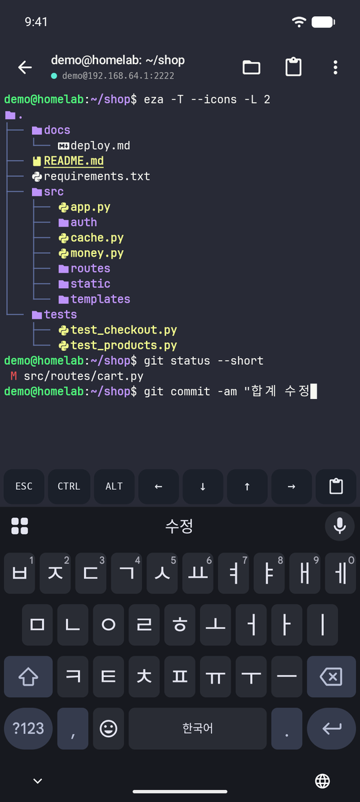
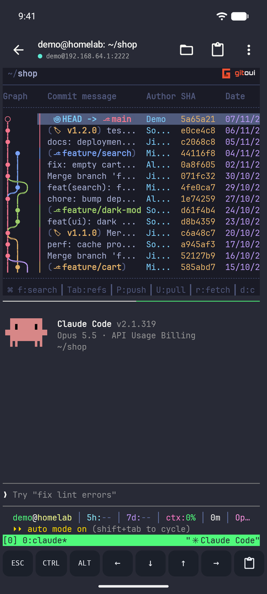

# Tern

[English](README.md) | 한국어

Tern은 깔끔한 디자인의 가볍고 현대적인 Android용 SSH, SFTP 터미널입니다. 한글 입력을 자연스럽게 지원합니다.

  
  

- 일반 입력창처럼 음성 입력과 자동 수정 사용 가능
- 한글 자판 상태에서도 Ctrl 단축키 사용 가능(CTRL + ㅊ = Ctrl-C)
- 인라인 이미지 표시(iTerm2, kitty 프로토콜)
- 모든 폰트에서 너드 폰트 아이콘 표시
- 양자 내성 키 교환 기본 사용
- 광고, 계정, 데이터 수집 없음([개인정보처리방침](docs/privacy.md))

Tern Pro를 한 번 구매하면 포트 포워딩, 점프 호스트, 에이전트 포워딩을 사용할 수 있습니다.
