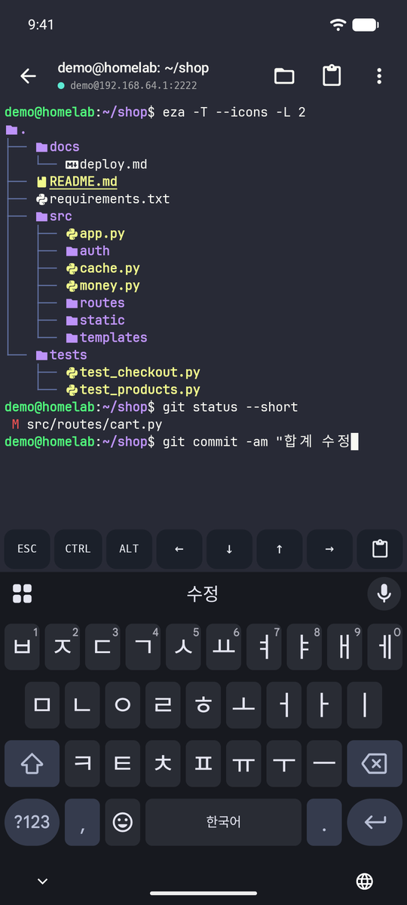
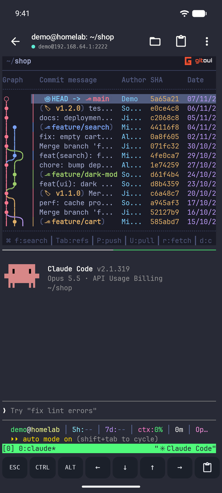

# Tern

Tern is a modern, lightweight SSH and SFTP terminal for Android with a clean design and natural Korean input.

  
  

- Voice typing and autocorrect work as in any text field
- Inline images (iTerm2 and kitty protocols)
- Nerd Font icons with any font
- Post-quantum key exchange by default
- No ads, no account, no data collection ([privacy policy](docs/privacy.md))

Port forwarding, jump hosts and agent forwarding are available with Tern Pro, a one-time purchase.
